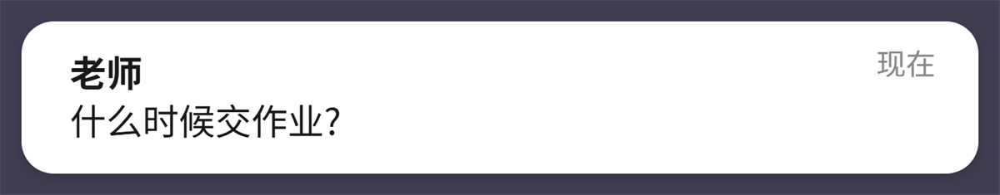
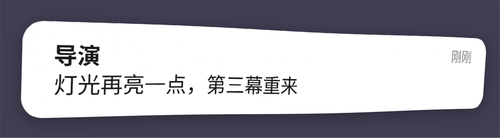

# 微信通知横幅生成器 · WeChat Notification Banner Generator

输入「用户名 / 内容 / 时间」，实时生成逐像素对齐 iOS 通知栏的微信横幅通知图，支持**随机 3D 变形**并导出透明底 PNG。

纯前端、零依赖、单文件、离线可用 —— 下载 `index.html` 双击就能用。

> A zero-dependency, single-file web tool that renders pixel-accurate iOS-style WeChat notification banners (with optional random 3D deformation) and exports transparent PNGs for film / stage compositing.

## 效果

标准横幅（逐像素对齐 iOS 通知栏）：



开启「随机变形」后（种子 1013）：



同一条消息，不同种子 = 不同造型（适合「一幕里冒出很多弹窗」）：


## 功能

- **输入即所见**：用户名、聊天内容（自动换行）、时间，实时预览
- **像素级还原**：所有尺寸不是目测，而是从一张真实 iOS 通知栏截图逐像素反推出来的（见下方数据表）
- **随机 3D 变形**：三种形态随机、强度可调、**种子可复现**
- **导出**：1×/2×/3×/4× 透明底 PNG，也可直接复制到剪贴板
- **背景**：透明 / 纯色 / 自定义图片（可调模糊与压暗，模拟锁屏壁纸）
- **细节可调**：图标开关、时间开关、投影、圆角、最多行数、字体
- **全屏演示**：带通知滑入动画，适合排练或现场当作背景
- **URL 参数**：可脚本化批量出图（见下方说明）
- 单文件 ~50 KB，零外部依赖，`file://` 直接打开即可，不需要服务器

## 快速开始

1. 下载 `index.html`
2. 双击用 Chrome / Edge 打开
3. 填内容 → 点「下载 PNG 图片」

想要在线版：在仓库 Settings → Pages 里把 Source 设为 `main` 分支根目录即可。

### 关于图标（重要）

**本仓库不附带微信图标**。微信图标是腾讯的商标与著作权素材，放进公开仓库会有风险，所以默认渲染的是「无图标」版式（文字会自动左移，不会留空位）。

想还原参考图的外观：

1. 打开「细节与输出设置」→「替换图标」
2. 选择你自己的图标图片（正方形 PNG 最佳）

图标会以 iOS 圆角比例（0.2237 × 边长）裁切后绘制，位置与尺寸严格对齐。

## 版式还原有多准

所有常量都来自对一张真实截图（747×144，iPhone @2x）的逐像素测量：

| 元素 | 常量 | 说明 |
|---|---|---|
| 画布 | 744 × 146 | 对应 375pt 宽屏 @2x |
| 弹窗 | 712 × 113，圆角 24 | 四周留白 16 |
| 图标 | 79 × 79（=38pt） | 距弹窗左 23，垂直居中，iOS 圆角比例 |
| 用户名 | 27px / 600 | 距弹窗顶 **墨迹** 26 |
| 正文 | 27px / 400，行高 36 | 首行墨迹距用户名墨迹 36 |
| 时间 | 22px | 墨迹距弹窗顶 21，右距弹窗边 33 |
| 文字颜色 | `#191919` | 实测最暗像素 `#121214` |
| 时间颜色 | `#888888` | 实测最暗像素 `#858585` |
| 气泡 | `#FFFFFF` | 纯白 |

关键做法：**不是用 font-size + padding 估算**，而是用 `measureText()` 的 `actualBoundingBox*` 反推文字**墨迹**（ink）的位置，再把墨迹的左上角精确放到目标坐标。因此换字体后版式也不会散。实测对齐偏差：

| 元素 | 参考图 | 本工具输出 | 偏差 |
|---|---|---|---|
| 图标 | x 40–117, y 34–114 | x 39–117, y 34–112 | ≤ 2px |
| 用户名墨迹 | x 141–190, y 42–67 | x 140–191, y 42–66 | ≤ 1px |
| 正文墨迹 | x 141–341, y 77–102 | x 140–338, y 78–102 | ≤ 3px |
| 时间墨迹 | x 652–694, y 37–59 | x 653–694, y 38–57 | ≤ 2px |

（≤3px 的差异来自字体：参考图是 iOS 苹方 PingFang SC，本项目优先用它，没有则回落到 Noto Sans SC / 微软雅黑，字形宽度略有不同。）

## 随机变形

勾选「随机变形」后，每次都会得到一个新的造型。实现方式不是简单的 skew，而是真正的 3D 变换：

1. 先按标准版式渲染成位图
2. 对每个采样点做 **3D 旋转（X/Y/Z）→ 圆柱卷曲 → 透视除法**
3. 拆成 30 × 8 网格，逐格求仿射矩阵贴图（格子外扩 0.55px 消除接缝）

三种形态按种子随机分配：

| 形态 | 特征 |
|---|---|
| `flip` | 整体绕 Y 轴翻转，近大远小，一端被压缩 |
| `curl` | 绕竖直圆柱卷曲，两端向后弯，轮廓成弧形 |
| `mix` | 两者兼有，最接近「卡片翻滚」的观感 |

因为图标、文字、圆角、投影都在同一张位图里被一起变形，所以放大 3 倍看也不会穿帮。

**种子**：同一种子永远得到完全相同的造型。影片里某个造型想复用，记下种子号即可，导出文件名也会带上它。

**强度**：20%–140%，100% 与参考幅度相当。

**画布**（变形后画布怎么算）：

| 选项 | 行为 | 适合 |
|---|---|---|
| 随形扩展 | 画布跟着变形轮廓放大 | 单张出图，尺寸最大 |
| 定宽一致 | 画布宽度固定，高度随形 | **多张叠放**，尺寸统一 |
| 固定原尺寸 | 画布永远是 744×146，内容缩到框内 | 需要严格固定画幅 |

## URL 参数（批量出图）

加 `?mode=raw` 后只渲染画布、不显示界面，适合脚本批量出图或自动截图：

| 参数 | 说明 |
|---|---|
| `mode=raw` | 只渲染画布，隐藏界面 |
| `emit=1` | 把 PNG 的 dataURL 写进 `#raw-meta`，便于脚本提取 |
| `u` / `m` / `t` | 用户名 / 聊天内容 / 时间 |
| `s` | 导出倍率 1–4 |
| `bg` | `none` / `color` / `image` |
| `c` | 背景色，如 `%233f3e52` |
| `shadow` | `0` / `1` |
| `deform` | `1` 开启随机变形 |
| `seed` | 变形种子（`random` 表示随机） |
| `amount` | 变形强度 20–140 |
| `fit` | `fit` / `width` / `fixed` |
| `icon` / `showtime` | `0` / `1` |
| `radius` | 圆角 |

示例：

```
index.html?mode=raw&u=老师&m=什么时候交作业?&t=现在&s=3&deform=1&seed=1013&fit=width
```

`tools/batch-export.ps1` 是一个现成的批量脚本（Windows）：

```powershell
.\tools\batch-export.ps1 -Seed 1013,7,42,8888 -Scale 3 -OutDir .\out
```

## 构建

`index.html` 是单文件成品，源码在 `src/`：

```
src/template.html   源模板（含 __WECHAT_ICON_DATAURI__ 占位符）
src/build.js        构建脚本：把图标 base64 内嵌进单文件
```

```bash
# 不带图标（默认，公开版）
node src/build.js --template src/template.html --no-icon --out index.html

# 内嵌自己的图标
node src/build.js --template src/template.html --icon my-icon.png --out index.html
```

## 与同类项目的区别

「假微信截图」这个大类项目不少，但据我检索，**没有一个是做通知横幅的**：

| 项目 | 做什么 | 与本项目的关系 |
|---|---|---|
| [WechatMomentScreenshot](https://github.com/TransparentLC/WechatMomentScreenshot) | 朋友圈转发截图 | 形态是朋友圈，不是通知栏 |
| [wechat-dialog-generator](https://github.com/gaopengbin/wechat-dialog-generator) | 聊天记录截图（红包/转账/语音） | 形态是聊天窗口内的对话气泡 |
| [fake-world](https://github.com/LiangNiang/fake-world) | 高仿微信 Web 应用 | 应用模拟，不用于出图 |

本项目的差异点：

1. **形态**：iOS/微信横幅通知（锁屏通知），不是聊天窗口、不是朋友圈
2. **精度**：逐像素反推的版式常量 + 墨迹对齐，而不是目测
3. **随机 3D 变形**：可复现的种子系统
4. **工程**：单文件零依赖透明底 PNG 直出，可直接进剪辑软件

## 已知限制

- 字体：参考图用的是 iOS 苹方（PingFang SC，苹果专有字体）。macOS 上会直接命中；Windows 上回落到 Noto Sans SC，个别字宽相差 1–3px
- 变形使用网格仿射近似透视，极端强度下极小概率出现亚像素级接缝
- 剪贴板复制需要浏览器允许（`file://` 下部分浏览器会拒绝，改用「下载 PNG」即可）

## 使用限制

本项目面向**影视、舞台演出、教学演示、UI 测试**等场景。

**禁止**用于以下用途：

- 伪造聊天记录作为证据、要挟或误导他人
- 电信诈骗、虚假交易凭证、虚假宣传
- 微商引流、批量生成用于广告投放
- 将本项目或生成的图片有偿售卖

生成的图片请自行确保不侵犯他人姓名权、肖像权、名誉权。使用本项目产生的一切后果由使用者承担。

## 商标声明

「微信 / WeChat」是腾讯科技（深圳）有限公司的商标。本项目与腾讯公司**没有任何关系**，未获其授权或认可。

本项目**不包含**任何腾讯的图标素材。使用者自行上传图标的行为及后果由使用者自负。如腾讯公司认为本项目存在不当之处，请通过 Issue 联系，我会立即处理。

## License

[MIT](LICENSE) © 2026 SpacedSine

（MIT 仅覆盖本仓库中的代码。第三方商标与图标素材不在授权范围内。）
