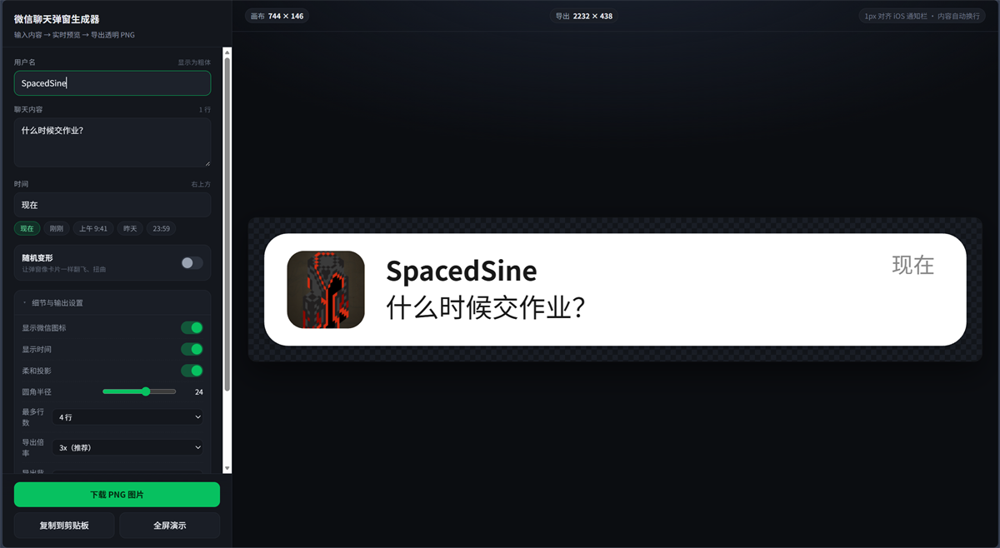
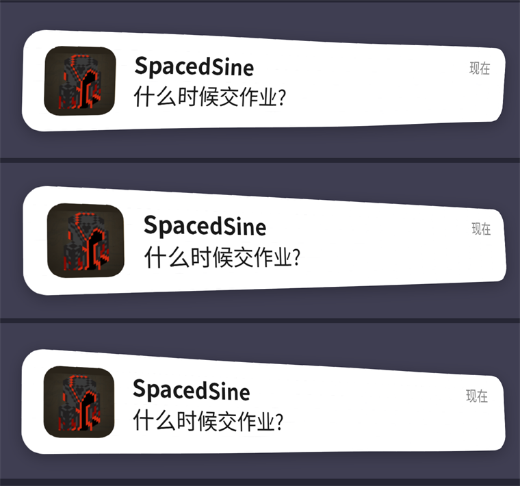

<div align="center">

# 微信通知横幅生成器

**填内容 → 实时预览 → 一键导出透明 PNG**

逐像素对齐 iOS 通知栏 · 头像/名字/内容/时间全部可改 · 4 倍导出投屏不糊

<sub>单文件 50 KB · 零依赖 · 离线可用 · 双击即开</sub>

</div>



<p align="center"><sub>左边填内容，右边实时预览，点一下就是一张透明底 PNG</sub></p>

## 它是什么

一个 HTML 文件。打开、填字、下载，三秒出一条「微信收到新消息」的横幅通知图。

做影视短剧的手机特写、舞台演出的背景画面、产品演示的 UI 稿、通知栏样式的设计参考——不用开 PS，也不用在 AE 里画圆角矩形。

## 三步就能用

1. 下载 [`index.html`](index.html)，双击用 Chrome / Edge 打开
2. 填「用户名」「聊天内容」「时间」
3. 点 **下载 PNG 图片**


## 头像能换成任何图片

这是它比同类工具更实用的一点：**图标不是写死的**，任何一张图片都能变成通知头像。

> 想做成别的 App 的通知？换成那个 App 的图标就行。
> 想做成某个角色发来的消息？上传那个角色的头像就行。

操作只有两步：

1. 展开左下角 **「细节与输出设置」**
2. 在 **「替换图标」** 里选一张图片

上传后会自动按 iOS 圆角比例（0.2237 × 边长）裁切，尺寸和位置与系统通知完全一致。建议用**正方形图片**，非正方形会被缩放填满方形区域。

> ⚠️ 本仓库**不附带**任何第三方图标（上面示例里的头像是项目作者自己的）。微信图标属于腾讯的商标素材，请自行准备；只想做通用通知样式的话，用任何一张方图即可。

## 为什么它"像真的"

版式不是靠眼睛估的，而是从一张真实 iOS 通知栏截图上逐像素量出来的：

| 元素 | 常量 | 说明 |
|---|---|---|
| 画布 | 744 × 146 | 对应 375pt 宽屏 @2x |
| 弹窗 | 712 × 113，圆角 24 | 四边留白 16 |
| 图标 | 79 × 79（=38pt） | 距弹窗左 23，垂直居中，iOS 圆角比例 |
| 用户名 | 27px / 600 | 距弹窗顶**墨迹** 26 |
| 正文 | 27px / 400，行高 36 | 首行墨迹距用户名墨迹 36 |
| 时间 | 22px `#888888` | 墨迹距顶 21，右距边 33 |
| 文字色 | `#191919` | 实测最暗像素 `#121214` |
| 气泡 | `#FFFFFF` | 纯白 + 柔和投影 |

关键细节：文字位置**不是**用 `font-size + padding` 估的，而是用 `measureText()` 的 `actualBoundingBox*` 反推**墨迹**（ink）边界，再把墨迹左上角精确放到目标坐标。所以换字体、改字号，版式都不会散。

实测对齐偏差：

| 元素 | 参考图 | 本工具输出 | 偏差 |
|---|---|---|---|
| 图标 | x 40–117, y 34–114 | x 39–117, y 34–112 | ≤ 2px |
| 用户名墨迹 | x 141–190, y 42–67 | x 140–191, y 42–66 | ≤ 1px |
| 正文墨迹 | x 141–341, y 77–102 | x 140–338, y 78–102 | ≤ 3px |
| 时间墨迹 | x 652–694, y 37–59 | x 653–694, y 38–57 | ≤ 2px |

## 功能一览

| 功能 | 说明 |
|---|---|
| 实时预览 | 左边改字，右边立刻变 |
| 自定义头像 | 任意图片，自动 iOS 圆角裁切 |
| 自动换行 | 长消息自动断行，气泡跟着变高，超出按行数截断 |
| 透明底导出 | 1×–4× 可选，直接拖进剪映 / PR / AE / FCP 合成 |
| 背景可换 | 透明 / 纯色 / 自定义图片（带模糊与压暗，模拟锁屏壁纸） |
| 细节可调 | 图标开关、时间开关、投影、圆角、最多行数、字体 |
| 复制到剪贴板 | 不想存文件时直接粘贴 |
| 全屏演示 | 带通知滑入动画，可当排练或现场背景 |
| 批量出图 | URL 参数驱动，脚本一次生成一整场戏的弹窗 |
| 随机变形 | 可选的小彩蛋，见下 |

## 随机变形（可选）

勾上「随机变形」，弹窗会像卡片一样翻飞——3D 翻转、圆柱卷曲、透视，三种形态随机，强度可调，**种子可复现**（记下种子号就能找回同一个造型）。做「一堆弹窗飞出来」的镜头时比较省事。



## 导出与批量

除了点按钮，也能用 URL 参数脚本化生成（`?mode=raw` 会只渲染画布、不显示界面）：

```
index.html?mode=raw&u=老师&m=什么时候交作业?&t=现在&s=3&bg=none
```

| 参数 | 说明 |
|---|---|
| `mode=raw` | 只渲染画布，隐藏界面 |
| `emit=1` | 把 PNG 的 dataURL 写进 `#raw-meta`，便于脚本提取 |
| `u` / `m` / `t` | 用户名 / 聊天内容 / 时间 |
| `s` | 导出倍率 1–4 |
| `bg` | `none` / `color` / `image` |
| `c` | 背景色，如 `%233f3e52` |
| `shadow` | `0` / `1` |
| `icon` / `showtime` | `0` / `1` |
| `radius` | 圆角 |
| `deform` / `seed` / `amount` / `fit` | 变形开关 / 种子 / 强度 / 画布模式 |

`tools/batch-export.ps1` 是现成的批量脚本（Windows）：

```powershell
.\tools\batch-export.ps1 -Seed 1013,7,42,8888 -Scale 3 -OutDir .\out
```

它会用无头 Chrome 调同一个导出通道，所以拿到的图和你点「下载」完全一致。

## 构建

`index.html` 是单文件成品，源码在 `src/`：

```
src/template.html   源模板（含 __WECHAT_ICON_DATAURI__ 占位符）
src/build.js        构建脚本：把图标 base64 内嵌进单文件
```

```bash
# 不带图标（默认，即本仓库发布的版本）
node src/build.js --template src/template.html --no-icon --out index.html

# 内嵌自己的图标，开箱就带头像
node src/build.js --template src/template.html --icon my-avatar.png --out index.html
```

## 与其他项目的区别

「假微信截图」这个大类项目不少，但据我检索，**没有一个是做通知横幅的**：

| 项目 | 做什么 | 与本项目的关系 |
|---|---|---|
| [WechatMomentScreenshot](https://github.com/TransparentLC/WechatMomentScreenshot) | 朋友圈转发截图 | 形态是朋友圈，不是通知栏 |
| [wechat-dialog-generator](https://github.com/gaopengbin/wechat-dialog-generator) | 聊天记录截图（红包/转账/语音） | 形态是聊天窗口内的对话气泡 |
| [fake-world](https://github.com/LiangNiang/fake-world) | 高仿微信 Web 应用 | 应用模拟，不用于出图 |

差异点：**通知横幅形态** + **逐像素版式** + **任意头像替换** + **单文件零依赖透明 PNG 直出**。

## 已知限制

- 字体：参考图用 iOS 苹方（PingFang SC，苹果专有）。macOS 上直接命中；Windows 回落到 Noto Sans SC，个别字宽差 1–3px
- 非正方形头像会被缩放填满方形区域，建议预先裁成正方形
- 「复制到剪贴板」在 `file://` 下部分浏览器会拒绝，改用「下载 PNG」即可
- 变形使用网格仿射近似透视，极端强度下极小概率出现亚像素级接缝

## 使用限制

本项目面向**影视、舞台演出、教学演示、UI 测试**等场景。

**禁止**用于：伪造聊天记录作为证据或误导他人、电信诈骗与虚假交易凭证、微商引流与批量广告投放、将本项目或生成图片有偿售卖。

生成的图片请自行确保不侵犯他人姓名权、肖像权、名誉权。使用本项目产生的一切后果由使用者承担。

## 商标声明

「微信 / WeChat」是腾讯科技（深圳）有限公司的商标。本项目与腾讯公司**没有任何关系**，未获其授权或认可。

本仓库**不包含**任何腾讯的图标素材；使用者自行上传图标的行为及后果自负。若腾讯公司认为本项目存在不当之处，请通过 Issue 联系，会立即处理。

## License

[MIT](LICENSE) © 2026 SpacedSine

（MIT 仅覆盖本仓库中的代码，第三方商标、字体与图标素材不在授权范围内。）
